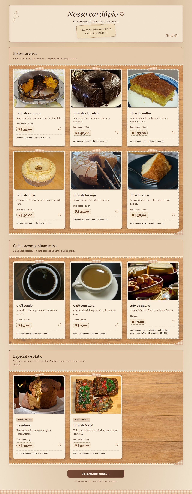
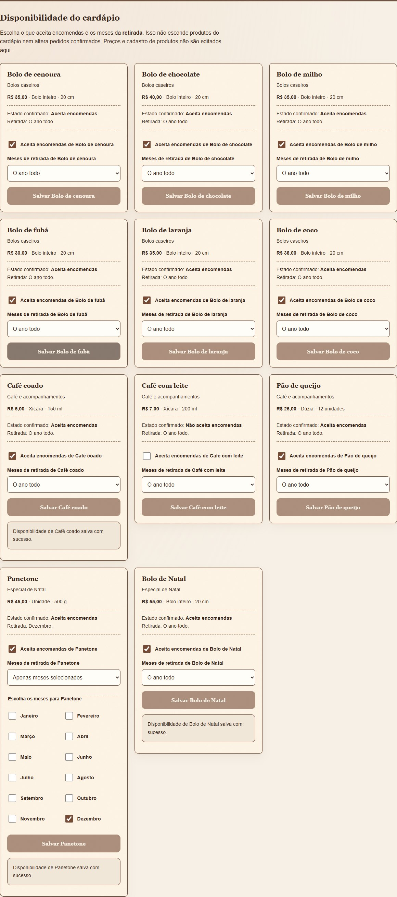

# Café do Bairro

Aplicação Full Stack desenvolvida para o processo seletivo da **TecnoJr 2026.2**, a partir do cenário de Dona Marta: uma cafeteria que recebe encomendas pelo WhatsApp e organiza os pedidos em um caderno.

A solução reúne um site responsivo para consultar o cardápio e registrar encomendas e um painel administrativo para acompanhar pedidos e controlar produtos disponíveis. O objetivo é facilitar o atendimento e evitar reservas acima da capacidade diária.

**Projeto acadêmico demonstrativo:** os pedidos ficam registrados no sistema, mas não geram preparação real de produtos.

## Da entrevista à solução

A identidade visual representa um **café acolhedor, inspirado em uma casa de vó**. Tons terrosos e marrons, texturas de papel e madeira, fundos xadrez que lembram toalhas de mesa, elementos botânicos e fotografias dos produtos compõem uma apresentação calorosa e familiar, pensada primeiro para o celular.

As necessidades de Dona Marta orientaram as decisões funcionais:

| Necessidade | Resposta da aplicação |
| --- | --- |
| Organizar a produção | Cinco unidades de produção por dia, compartilhadas entre bolos e panetones. O acompanhamento de pão de queijo não consome esse limite. |
| Ter tempo para preparar | Retirada a partir de amanhã, considerando o calendário de `America/Bahia`, sem exigir 24 horas exatas. |
| Evitar aprovação manual | Havendo disponibilidade, o pedido é registrado como `recebida` e sua capacidade fica reservada automaticamente. |
| Manter o pagamento simples | Pagamento na retirada, sem checkout ou integração de pagamento online. |
| Atender pedidos variados | Seis bolos caseiros, bolo de Natal e panetone como itens individuais; pão de queijo exclusivamente como acompanhamento opcional de bolos, uma dúzia por pedido. |
| Vender panetones e bolos de Natal em dezembro | A menção a essas vendas sazonais motivou o controle dos meses de retirada em que cada produto aceita encomendas. |
| Atualizar informações e oferta | Informações comerciais centralizadas em configuração; disponibilidade e meses dos produtos gerenciados pelo painel. |

O [brief original](BRIEF.md) foi preservado como registro inicial. A entrega evoluiu da simplificação de cinco pedidos de um produto para **cinco unidades de produção**, distribuídas entre encomendas com múltiplos itens. Todos os status contam para o limite; marcar como entregue não libera a capacidade daquela data.

A sazonalidade considera o **mês da retirada**, não o mês do pedido: em novembro é possível encomendar um panetone habilitado para dezembro. Os produtos natalinos começam desabilitados, com dezembro selecionado; a administradora decide quando habilitá-los.

Somente **bolos e panetone** podem ser escolhidos no formulário e ter disponibilidade e meses configurados no painel. **Café coado e café com leite permanecem no cardápio, para consumo no local, sem encomenda.** Pão de queijo não é um produto principal: o checkbox acrescenta **uma dúzia por R$ 25,00** quando há ao menos um bolo caseiro ou bolo de Natal. Panetone sozinho não permite acompanhamento. Remover o último bolo exige desmarcar o acompanhamento ou adicionar um bolo, preservando os demais campos.

Essas restrições são verificadas no backend, inclusive em edições administrativas, e independem das configurações antigas de café e pão de queijo no SQLite. **Não há nova migração de esquema nem conversão automática de pedidos.** Itens, quantidades e preços históricos são mantidos; contato e status podem ser editados mesmo em pedidos antigos com itens hoje proibidos. Alterar a composição, a data ou o acompanhamento exige uma composição válida pelas regras atuais; bolos/panetones mantidos ou reduzidos continuam dispensados de reativação. Publique frontend e backend juntos e encerre versões antigas da API para que todos os escritores apliquem as mesmas regras.

## Funcionalidades principais

### Área do cliente

- Cardápio com 11 produtos, fotografias locais, descrições, tamanhos e preços.
- Consulta de disponibilidade por data e dos produtos habilitados para o mês da retirada.
- Formulário expansível com produtos e quantidades, preservando o preenchimento ao fechar e reabrir.
- Registro da encomenda com número do pedido e resumo dos valores calculados pelo servidor, após a confirmação.
- Validação e recuperação de conflito sem apagar o rascunho.
- Informações comerciais e links de WhatsApp e Instagram, com nova aba segura e indicação acessível não visual.

### Área administrativa

- Autenticação com credenciais configuradas no servidor e sessão protegida.
- Listagem e filtros por data, prazo de retirada e status.
- Edição de contato, itens, quantidades, data, acompanhamento e status: `recebida`, `em preparo` e `entregue`.
- Exclusão com confirmação explícita, liberando a produção reservada pelo pedido.
- Resumo financeiro e prévia da edição, preservando os preços registrados nos itens existentes.
- Gerenciamento da disponibilidade e dos meses dos oito produtos encomendáveis (bolos e panetone), com persistência no SQLite.

O painel não edita preços, cadastro dos produtos, endereço ou horários. Dados comerciais ficam em `frontend/src/data/cafeConfig.ts`; nomes, descrições e imagens em `backend/src/produtos.ts`; preços em centavos em `backend/src/catalogo.ts`. Alterar esses arquivos exige nova publicação. Disponibilidade e meses são gerenciados pela interface.

<details>
<summary>Ver capturas reais do cardápio e do controle administrativo</summary>

Registros das validações de apresentação comercial e sazonalidade. As configurações do painel são exemplos usados nos testes.





</details>

## Tecnologias utilizadas

| Tecnologia | Papel no projeto |
| --- | --- |
| React e TypeScript | Interface baseada em componentes, formulários e contratos tipados. |
| Vite | Desenvolvimento, proxy da API e build do frontend. |
| HTML e CSS | Estrutura semântica, responsividade e identidade visual sem framework de estilos. |
| Node.js e Express | API REST, autenticação e regras de negócio, também em TypeScript. |
| SQLite | Persistência de encomendas, preços históricos e configurações, usando `node:sqlite`. |
| Git e GitHub | Versionamento e organização do código e da documentação. |

<a id="executar"></a>

## Como executar localmente

Requer **Node.js 24.11.0 ou superior** e npm. Os exemplos usam Windows/PowerShell: `npm.cmd` evita o bloqueio de `npm.ps1`; em outros terminais, use `npm`.

Abra dois terminais na raiz do repositório.

**Terminal 1 — API:**

```powershell
cd backend
npm.cmd ci
npm.cmd run dev
```

A API escuta em `http://127.0.0.1:3001`. O SQLite é criado automaticamente em `backend/data/cafe.sqlite`; `DATABASE_PATH` permite escolher outro arquivo. Antes de atualizar uma base que precisa preservar, siga o [procedimento de backup](backend/README.md#persistência-capacidade-e-concorrência).

**Terminal 2 — site:**

```powershell
cd frontend
npm.cmd ci
npm.cmd run dev
```

Abra **http://127.0.0.1:5173**, ou o endereço informado pelo Vite. O proxy encaminha `/api` para a API local. Mantenha os dois processos ativos; `Ctrl+C` encerra cada um.

O formulário público funciona sem credenciais administrativas. Para usar o painel, configure o servidor conforme a próxima seção. Se a instalação apresentar erro de certificado no Node 24, tente `$env:NODE_USE_SYSTEM_CA='1'` e repita o comando, mantendo a validação HTTPS.

<a id="habilitar-o-painel-administrativo"></a>

## Como acessar o painel administrativo

O painel fica em **http://127.0.0.1:5173/admin** e no link **Área administrativa** do rodapé. **Não existe usuário ou senha padrão.**

No terminal da API, interrompa o processo com `Ctrl+C`. Ainda na pasta `backend/`, escolha seu usuário e uma senha entre **12 e 128 caracteres**:

```powershell
$env:ADMIN_USER = Read-Host 'Escolha o usuário administrativo'
$senhaSegura = Read-Host 'Escolha a senha administrativa' -AsSecureString
$senhaTexto = [System.Net.NetworkCredential]::new('', $senhaSegura).Password
$env:ADMIN_PASSWORD_HASH = $senhaTexto | node --experimental-strip-types src/gerar-senha.ts
$codigoHash = $LASTEXITCODE
Remove-Variable senhaTexto, senhaSegura
if ($codigoHash -ne 0) { throw 'Não foi possível gerar o hash da senha.' }
$env:ADMIN_ORIGIN = 'http://127.0.0.1:5173'
npm.cmd run dev
```

A senha não é exibida nem enviada como argumento de linha de comando; o servidor recebe seu hash `scrypt`. Entre com as credenciais escolhidas. Não é necessário configurar `ADMIN_TOKEN` para usar o painel.

`ADMIN_ORIGIN` deve corresponder exatamente à origem do site. Se o Vite escolher outra porta, ajuste a variável e reinicie a API; `localhost` e `127.0.0.1` são origens diferentes.

As variáveis duram enquanto o terminal estiver aberto. Não há carregamento automático de `.env`; consulte as alternativas no [README da API](backend/README.md). Não versione senhas, hashes ou tokens nem os coloque em variáveis `VITE_*`.

A sessão expira em até oito horas e termina ao sair ou reiniciar a API, sem apagar pedidos. Cookies `HttpOnly`, validação de origem e token CSRF protegem as operações. Em produção, a configuração exige HTTPS e cookie `Secure`.

## Arquitetura e organização do projeto

**React → API Express → SQLite**

O React apresenta a interface e envia solicitações HTTP. O Express valida os dados, autentica as operações administrativas e aplica as regras de negócio. O SQLite armazena encomendas, itens e configurações persistentes.

A API verifica disponibilidade e grava a encomenda na mesma transação `BEGIN IMMEDIATE`, protegendo o limite diário contra pedidos concorrentes. Os preços unitários são armazenados em centavos, e os totais são derivados dos valores registrados.

```text
frontend/
  src/       Componentes, seções, painel, hooks, serviços, configurações e estilos
  tests/     Testes de utilitários, contratos e integração React/API
backend/
  src/       Express, rotas, autenticação, regras, catálogo e persistência
  tests/     Testes HTTP, migrações, preços, segurança e concorrência
scripts/     Auditorias de navegador e apoio às imagens
docs/        Decisões, revisões, capturas e evidências
BRIEF.md     Requisitos iniciais e contexto do desafio
```

Catálogo e cálculos puros são reutilizados entre frontend e backend no mesmo repositório. O [README técnico da API](backend/README.md) detalha endpoints, variáveis de ambiente, persistência e migrações.

## Testes e qualidade

A [revisão final documentada](docs/revisao-arquitetural/README.md#verificações-desta-conclusão) registra **87 testes frontend e 62 testes backend aprovados**, além de lint, verificação TypeScript e builds. Os cenários cobrem pedidos, sessão/CSRF, conflitos com preservação do rascunho, preços históricos, migrações com rollback e concorrência entre processos.

As auditorias em Edge/Chromium verificaram larguras de **360, 390, 768 e 1280 px**, teclado, movimento reduzido, contatos interceptados e integração com SQLite temporário. Os relatórios finais de [fluxo público](docs/revisao-arquitetural/navegador-final/publico.json), [apresentação comercial](docs/revisao-arquitetural/navegador-final/comercial.json) e [sazonalidade](docs/revisao-arquitetural/navegador-final/sazonais.json) registram, respectivamente, **7, 11 e 16 análises axe sem violações detectadas**. Isso não substitui testes com leitor de tela, outros navegadores ou aparelhos físicos.

Para reproduzir, partindo da raiz e com as dependências das duas pastas instaladas:

```powershell
Push-Location frontend
npm.cmd test
npm.cmd run lint
npm.cmd exec -- tsc -b
npm.cmd run build
Pop-Location

Push-Location backend
npm.cmd test
npm.cmd run typecheck
npm.cmd run build
Pop-Location
```

Os testes usam bancos em memória ou arquivos temporários, sem depender da base de desenvolvimento. O frontend verifica tipos com `tsc -b`, também executado pelo build; o backend não possui comando de lint. No Node 24.11, o aviso experimental de `node:sqlite` é esperado.

<details>
<summary>Reproduzir as auditorias de navegador no Windows</summary>

Os roteiros usam Playwright, axe e o Microsoft Edge instalado. Se necessário, instale as ferramentas opcionais na pasta ignorada `.audit-tools`, a partir da raiz:

```powershell
npm.cmd install --prefix .audit-tools --no-save --package-lock=false playwright @axe-core/playwright
node --experimental-strip-types scripts/auditar-preentrega.mjs --comercial --sem-capturas --saida=docs/revisao-arquitetural/NOVA-RODADA/publico
node --experimental-strip-types scripts/testar-apresentacao-comercial.mjs --contatos --sem-capturas --saida=docs/revisao-arquitetural/NOVA-RODADA/comercial
```

Escolha uma pasta ainda não usada no lugar de `NOVA-RODADA`, preservando as evidências anteriores. Os roteiros iniciam e encerram seus servidores e bancos temporários; não precisam da API de desenvolvimento ativa. Os destinos externos são interceptados, sem acesso às contas nem envio de mensagens.

</details>

Os resultados históricos citados vêm das revisões registradas. A validação das regras definitivas e os comandos executados estão em [verificações das regras de encomenda](docs/regras-encomendas-final/README.md).

## Documentação complementar

- [Brief do desafio](BRIEF.md): necessidades da cliente, requisitos iniciais e direção visual.
- [API e execução técnica](backend/README.md): contratos, autenticação, ambiente e backup.
- [Revisão arquitetural e conclusão das auditorias](docs/revisao-arquitetural/README.md): melhorias, testes finais, evidências e limites conhecidos.
- [Auditoria integrada anterior](docs/auditoria-final/README.md): registro histórico do fluxo completo de um pedido.
- [Disponibilidade sazonal](docs/produtos-sazonais/README.md) e [precificação](docs/precificacao/README.md): decisões, persistência e preservação de dados.
- [Créditos das fotografias](docs/creditos-imagens.md): fontes, autores, licenças e adaptações.

Os documentos em `docs/` preservam o histórico das etapas; nomes de branches e contagens de testes neles refletem a versão auditada em cada ocasião.

## Observações sobre o ambiente demonstrativo

O Café do Bairro **não representa um estabelecimento comercial operacional**. Endereço, horários, cardápio, tamanhos e preços são referências fictícias autorizadas para o desafio. Use dados de teste: os pedidos demonstrativos ficam registrados no projeto, mas não serão preparados nem cobrados por uma cafeteria.

O WhatsApp foi autorizado por seu proprietário e abre uma conversa com mensagem pré-preenchida, sem envio automático. Conversas não criam nem sincronizam pedidos no SQLite. O botão Instagram aponta para [o perfil da TecnoJr](https://www.instagram.com/tecnojr/), não para um perfil próprio do café; isso não indica parceria comercial.

As fotografias do cardápio são referências licenciadas de alimentos, não registros de produtos desse estabelecimento fictício. A imagem do hero foi criada com IA e permanece identificada na interface. O desenvolvimento contou com apoio de **ChatGPT e Codex** na interpretação dos requisitos, implementação, testes, revisão e documentação.

A validação foi local. Uma implantação real exige HTTPS, proxy de `/api` na mesma origem, credenciais protegidas e backup/acesso restrito ao banco, conforme a documentação técnica.
