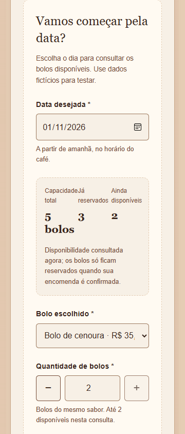
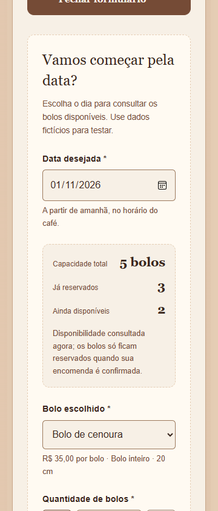

# Café do Bairro — revisão pré-entrega

Data: 31/10/2026. Escopo: landing page, fluxo de encomenda, integração HTTP, SQLite, CRUD, segurança administrativa e instruções de execução. Não foi implementado painel.

**Resultado:** não foi encontrado bloqueio funcional para a demonstração local após as correções abaixo. A inspeção visual foi feita em Edge/Chromium headless real, usando Playwright autorizado, em 360, 390, 768 e 1280 px. Os testes usaram somente dados fictícios e um arquivo SQLite temporário; não alteraram a base local de encomendas.

O brief foi lido junto às decisões posteriores: capacidade de cinco **bolos**, soma de `quantidadeBolos`, um sabor por registro e uma dúzia opcional de pão de queijo sem consumo da capacidade. Essas decisões estão documentadas no README e prevalecem sobre a simplificação histórica de cinco registros do brief.

## Requisitos concluídos

| Etapa auditada | Situação final | Evidência |
| --- | --- | --- |
| 1. Cabeçalho, hero, cardápio e navegação | OK nas quatro larguras; destinos internos existem; os dois CTAs de encomenda levam à seção correta. | Capturas de página/hero/cardápio abaixo e validação de âncoras no roteiro. |
| 2. Data, disponibilidade e preenchimento | OK: consulta real mostra limite 5, reservados 3, disponíveis 2; validação local e controle de quantidade funcionam. Fechar/reabrir mantém os dados. | [Data inicial](auditoria/03-data-primeiro-390.png), [validação](auditoria/04-validacao-390.png), [formulário mobile](auditoria/05-formulario-390.png). |
| 3. Envio e confirmação | OK: campos/botão bloqueados durante envio; submissão adicional ignorada; somente o `201` confirma com ID, quantidade e pagamento na retirada. | [Aguardando resposta](auditoria/06-envio-pendente-1280.png), [confirmação](auditoria/07-confirmacao-1280.png). |
| 4. Data lotada | OK: saldo zero, mensagem acolhedora e campos de bolo/contato ocultos. | [Dia lotado](auditoria/08-data-lotada-390.png). |
| 5. Concorrência e conflito de saldo | OK: outro pedido ocupa três bolos durante o preenchimento; POST de três recebe `409`; saldo é atualizado para dois; a quantidade pode ser reduzida sem apagar nome e telefone. O novo POST de dois confirma. | [Conflito e correção](auditoria/08b-conflito-390.png); testes em processos independentes para POST/PATCH. |
| 6. Informações, contatos e rodapé | OK: dados centralizados, avisos de demonstração, nenhum destino WhatsApp fictício. `/admin` mostra só aviso público, sem painel. | [Contato](auditoria/09-contato-390.png), [rodapé](auditoria/10-rodape-390.png), [aviso administrativo](auditoria/11-aviso-admin-390.png). |
| 7. Teclado, movimento e acessibilidade | OK no escopo testado: pular para conteúdo, foco de abertura/fechamento, campos fechados fora da navegação, rótulos e mensagens associados. Movimento reduzido torna a rolagem imediata. Axe sem violações nos seis estados examinados. | [Foco visível na data](auditoria/08-data-lotada-390.png), [resultado automatizado](auditoria/resultado.json). Não é certificação completa de WCAG. |
| 8. SQLite, regras e proteção administrativa | OK: pedidos criados no navegador persistem após fechar/reabrir o arquivo; todos os status consomem capacidade; alterações de data/quantidade e exclusão recalculam o saldo. A consulta pública não revela dados pessoais e listagem sem token é recusada. | Testes de CRUD/migração/concorrência e roteiro real de navegador. |

Outros requisitos verificados: status inicial `recebida`, antecedência no fuso `America/Bahia`, migração aditiva com um bolo por registro antigo, cafés e Natal fora do seletor de encomendas, produtos sazonais identificados, preços/endereço/contatos fictícios sinalizados e ausência de pagamentos online ou cadastro de clientes.

### Responsividade

| Largura | Página / formulário | Rolagem horizontal | Evidência visual |
| --- | --- | --- | --- |
| 360 px | Verificados | Não; `scrollWidth = 360` nos dois estados | [Página](auditoria/01-pagina-360.png), [hero](auditoria/02-hero-360.png), [cardápio](auditoria/02b-cardapio-360.png), [formulário](auditoria/05-formulario-360.png). |
| 390 px | Verificados | Não; `scrollWidth = 390` nos dois estados | [Página](auditoria/01-pagina-390.png), [hero](auditoria/02-hero-390.png), [cardápio](auditoria/02b-cardapio-390.png), [formulário](auditoria/05-formulario-390.png). |
| 768 px | Verificados | Não; `scrollWidth = 768` nos dois estados | [Página](auditoria/01-pagina-768.png), [hero](auditoria/02-hero-768.png), [cardápio](auditoria/02b-cardapio-768.png), [formulário](auditoria/05-formulario-768.png). |
| 1280 px | Verificados | Não; `scrollWidth = 1280` nos dois estados | [Página](auditoria/01-pagina-1280.png), [hero](auditoria/02-hero-1280.png), [cardápio](auditoria/02b-cardapio-1280.png), [formulário](auditoria/05-formulario-1280.png). |

As capturas foram salvas e inspecionadas nesta revisão. Em celular, o cardápio fica em uma coluna para permitir leitura e navegação sem controles de carrossel. A página é longa, mas os CTAs e as âncoras permitem chegar diretamente às encomendas.

## Problemas corrigidos

1. **Legibilidade dos contadores em 360 px — impacto médio.** Os três contadores ficavam comprimidos e os rótulos se encostavam. Agora usam linhas com rótulo/valor no celular e três colunas a partir de 768 px. Nenhuma regra de capacidade mudou.
2. **Opção do bolo cortava preço/tamanho — impacto médio.** O `<select>` passou a mostrar apenas o nome. Preço por bolo e tamanho ficam num texto associado ao campo, visíveis sem depender da largura do seletor.
3. **Telefone internacional devolvido pela API era recusado no PATCH — impacto médio.** Reproduzido com teste: criar com `+55`, receber o telefone normalizado em dígitos e reenviá-lo retornava `400`. Validações agora aceitam o DDI com ou sem `+`; a máscara distingue DDI do DDD 55. Dois testes de regressão cobrem o caso.
4. **`404` de favicon no console — impacto baixo.** Adicionado favicon a partir da xícara já existente na marca e referência explícita no HTML. Não foi criado um novo logotipo.
5. **Coração decorativo quebrava uma linha no hero — impacto baixo.** Ajustados tamanho/disposição e ocultado o ornamento na menor largura, removendo o espaço vazio desnecessário. O título e os dados foram preservados.

Comparação da mesma área em 360 px:

| Antes | Depois |
| --- | --- |
|  |  |

### Console e acessibilidade automatizada

- Nenhuma exceção JavaScript (`pageerror`) na execução final.
- Nenhuma falha de rede inesperada. O `404` do favicon foi eliminado.
- O navegador registra o `409 Conflict` deliberadamente provocado no teste; esse é o resultado correto da regra de capacidade, tratado pela interface. Não foi ocultado nem convertido em sucesso.
- Axe-core, regras WCAG 2 A/AA e 2.1 A/AA: **zero violações detectadas** em landing 390/1280, erros do formulário 390, preenchimento 1280, confirmação 1280 e aviso `/admin` 390.
- Teclado e movimento reduzido foram exercitados. Leitor de tela e dispositivos físicos não foram testados.

## Verificações executadas

| Verificação | Resultado |
| --- | --- |
| Front-end `npm.cmd test` | 32 testes passaram. |
| Front-end `npm.cmd run lint` | Passou sem avisos. |
| Front-end `npm.cmd run build` | TypeScript (`tsc -b`) e Vite passaram. |
| Back-end `npm.cmd test` | 21 testes passaram, incluindo concorrência entre processos e migração. |
| Back-end `npm.cmd run typecheck` | Aplicação e testes passaram. |
| Back-end `npm.cmd run build` | Passou. Não há comando de lint separado no back-end. |
| Playwright + Edge real | Oito etapas concluídas; as quatro larguras sem transbordamento horizontal. |
| Axe-core | Zero violações detectadas nos estados examinados. |

Ferramentas de navegador foram instaladas apenas em `.audit-tools/`, ignorada pelo Git. Nenhuma dependência de produção foi adicionada. O roteiro está em [scripts/auditar-preentrega.mjs](../scripts/auditar-preentrega.mjs), e os dados brutos estão em [resultado.json](auditoria/resultado.json).

## Pendências antes da entrega

1. **Conferência complementar:** Safari/iOS, Firefox, um celular físico, zoom e leitor de tela. As quatro larguras foram verificadas num navegador Chromium; isso não prova comportamento idêntico em todos os motores/dispositivos.
2. **Materiais visuais:** hero e produtos ainda usam ilustrações provisórias claramente identificadas. Fotografias autorizadas aproximariam a apresentação da referência aprovada. Dados reais não são obrigatórios pelo brief, e nenhum contato deve ser inventado para substituir a demonstração.
3. **Entrega/repositório:** conferir o link que será enviado à TecnoJr e reproduzir as instruções num clone limpo. Esta revisão não fez commit, push ou publicação.
4. **Se houver implantação pública:** configurar encaminhamento de `/api`, HTTPS e ambiente administrativo. O proxy do Vite é só de desenvolvimento. O painel não foi implementado e permanece fora desta etapa.

Não há bloqueio funcional conhecido para apresentar localmente os requisitos implementados. Esta conclusão é limitada às verificações descritas; não equivale a auditoria completa de segurança, conformidade WCAG ou validação em todos os navegadores.

## Executar e demonstrar localmente

Requer Node.js 24.11+ e npm. Em dois terminais inicialmente na raiz:

Terminal 1:

```powershell
cd backend
npm.cmd ci
npm.cmd run dev
```

Terminal 2:

```powershell
cd frontend
npm.cmd ci
npm.cmd run dev
```

Abra **http://127.0.0.1:5173** (ou a porta impressa pelo Vite). O POST e a consulta de saldo não exigem token; a mensagem de administração bloqueada no back-end é esperada sem `ADMIN_TOKEN`.

Roteiro sugerido para a banca:

1. Mostrar hero, cardápio e contatos, incluindo os avisos de dados fictícios e os contatos em demonstração.
2. Abrir a gaveta, escolher amanhã ou depois, conferir capacidade/reservados/disponíveis e escolher sabor e quantidade.
3. Preencher contato fictício, marcar a dúzia opcional, fechar/reabrir e mostrar que o preenchimento foi preservado.
4. Confirmar e mostrar número do pedido, pagamento na retirada e saldo atualizado. Isso grava um pedido de teste na base local.
5. Demonstrar uma data lotada ou o conflito entre duas abas, corrigindo quantidade/data sem perder os dados.
6. Para comprovar persistência, reiniciar o back-end e consultar o saldo da data novamente. Para demonstrar CRUD administrativo, usar os exemplos autenticados de [backend/README.md](../backend/README.md); nunca inserir o token no front-end.
7. Explicar a transação: o servidor obtém o direito de escrita, soma os bolos da data, só grava se couberem até cinco e confirma tudo junto. O banco, não o saldo exibido no navegador, decide a reserva.

Para repetir a auditoria em Windows com Edge instalado:

```powershell
npm.cmd install --prefix .audit-tools --no-save --package-lock=false playwright @axe-core/playwright
node --experimental-strip-types scripts/auditar-preentrega.mjs
```

O roteiro cria seus próprios servidores em portas temporárias, grava somente no SQLite temporário e encerra/remove esse banco ao terminar. Não precisa dos dois servidores de desenvolvimento ativos. As capturas em `docs/auditoria/` são atualizadas; as imagens iniciais de comparação ficam em `docs/auditoria/antes/`.
