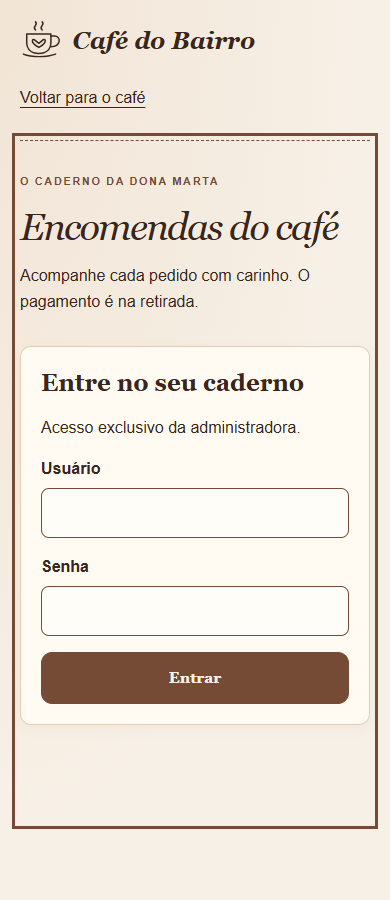
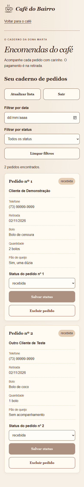
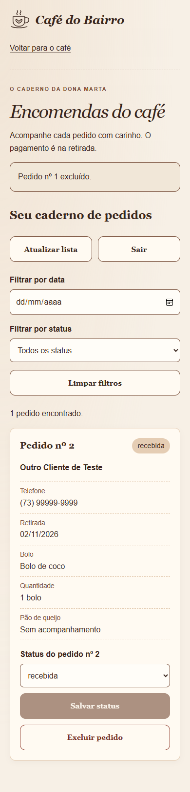
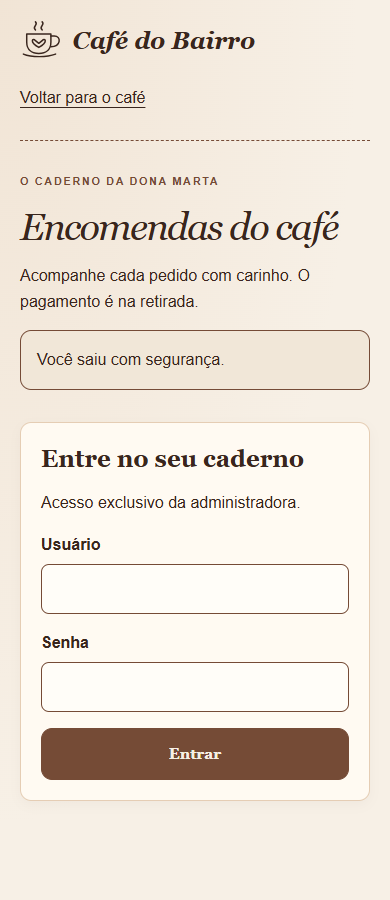

# Auditoria final integrada — Café do Bairro

**Data: 01/11/2026.** Revisão do código, testes HTTP/React e navegação real no Edge/Chromium. Foram usados apenas pedidos fictícios, credenciais de teste e arquivos SQLite temporários. A base local de desenvolvimento foi preservada. As evidências desta pasta foram capturadas nesta auditoria.

**Resultado:** os fluxos solicitados estão funcionando na execução local verificada. Foram corrigidos dois problemas pontuais no frontend, sem alterar o contrato da API, a autenticação, o esquema SQLite ou as regras de capacidade. Não foi encontrada falha funcional bloqueadora nos cenários executados. Isso não equivale a validação de uma implantação pública.

## Fluxo do mesmo pedido, do cliente à administradora

| Etapa | Verificação | Resultado e evidência |
| --- | --- | --- |
| 1 | Cliente sem autenticação pede dois bolos e uma dúzia opcional pelo formulário | **OK:** POST `201`, número do pedido, pagamento na retirada e registro `recebida` no SQLite. [Confirmação](01-cliente-confirmado-390.png). |
| 2 | Disponibilidade após a reserva | **OK:** limite 5, reservados 2, disponíveis 3; acompanhamento não consome bolos. A tela consulta o saldo novamente depois do sucesso. |
| 3 | Login e consulta administrativa | **OK:** o mesmo ID aparece com nome, telefone, sabor, quantidade, data, acompanhamento e status. [Pedido no painel](pedidos-390.png). |
| 4 | Alterar para `em preparo` e `entregue` | **OK:** o saldo não aumenta. Um segundo pedido de um bolo deixa três reservados e dois disponíveis. Após parar a API, fechar/reabrir SQLite e iniciar a API novamente, o status continua `entregue` e o saldo continua 2. A sessão anterior é invalidada e um novo login funciona. [Status persistido](02-status-persistido-390.png). |
| 5 | Excluir o pedido de dois bolos | **OK:** cancelar mantém o registro; confirmar apaga somente o pedido escolhido. O outro bolo permanece reservado e o saldo passa de 2 para 4. [Confirmação explícita](confirmacao-exclusao-390.png), [exclusão concluída](03-exclusao-concluida-390.png), [saldo público](03b-saldo-liberado-390.png). |
| 6 | Sair do painel | **OK:** nomes/telefones saem da tela. Reutilizar o cookie anterior também recebe `401` no servidor. [Após sair](04-logout-390.png). |
| 7 | Consultar ou modificar sem autenticação | **OK:** GET da lista, GET por ID, PATCH e DELETE recebem `401`, com apenas mensagem de erro. Após logout, listagem e alterações continuam bloqueadas. |
| 8 | Fluxo público depois do logout | **OK:** outro pedido de um bolo é confirmado pelo formulário sem login; com os dois bolos restantes na data, o saldo fica 3. [Nova confirmação pública](05-cliente-apos-logout-390.png). |

Os oito passos estão registrados também em [resultado.json](resultado.json). O teste reinicia a API e reabre o arquivo real de teste, em vez de apenas conferir estado em memória do React.

## Landing page, capacidade e segurança

A auditoria pública complementar verificou CTAs e âncoras, cardápio, contato e rodapé, abertura/fechamento da gaveta com preservação do rascunho, validação inicial, estado de envio com bloqueio de duplicidade, confirmação somente após `201`, dia lotado e recuperação de `409` mantendo os demais dados. [Resultados públicos](publico/resultado.json).

A suíte do backend continua cobrindo mudanças de data/quantidade com rollback, soma de bolos em todos os status, redução/exclusão liberando capacidade, antecedência em `America/Bahia`, migração dos registros antigos e concorrência entre processos no mesmo SQLite. A checagem continua dentro de `BEGIN IMMEDIATE`, antes de gravar; não foi substituída pela consulta de disponibilidade do navegador.

Login, expiração, logout, CSRF, origem, limite de tentativas e cookies HttpOnly/Secure permanecem cobertos. O Bearer administrativo continua testável pelo PowerShell. Não foram inseridos segredos no React, em variáveis `VITE_*` ou no armazenamento do navegador. A disponibilidade pública retorna somente data e quantidades agregadas.

## Correções feitas

| Problema reproduzido | Correção | Verificação |
| --- | --- | --- |
| Ao salvar status, a remontagem do cartão removia o controle focado e o navegador voltava ao `BODY`. | `Admin.tsx` devolve o foco ao seletor do pedido alterado depois da resposta e da renderização. | No navegador real, o foco agora é `SELECT#status-1`; a integração React também exige esse resultado. |
| O serviço administrativo aceitava `200` com JSON nulo, incompleto ou inválido como sessão/lista, podendo quebrar a renderização. O caso foi reproduzido com respostas simuladas; não foi uma resposta produzida pelo backend durante o fluxo normal. | `services/admin.ts` valida sessão, registros e confirmação de status antes de atualizar a interface. Falhas mostram erro e preservam a lista anteriormente carregada. | Dois testes de serviço e um cenário de integração verificam as respostas inválidas e a preservação dos cartões. |

Também foi isolada a janela de tempo dos cenários de login dos testes React. O sexto cenário novo encontrava corretamente o limite de cinco tentativas da API compartilhada; o relógio de teste agora avança entre cenários, sem desabilitar a proteção real.

Arquivos de aplicação alterados: `frontend/src/pages/Admin.tsx` e `frontend/src/services/admin.ts`. Foram ampliados `frontend/tests/admin-integracao.test.mjs`, os scripts de auditoria e a documentação, e criado `frontend/tests/admin-service.test.mjs`. Não foram adicionadas dependências à aplicação.

## Visual e acessibilidade

| Superfície | Larguras | Resultado |
| --- | --- | --- |
| Landing page e formulário aberto | 360, 390, 768, 1280 px | Sem rolagem horizontal; nenhuma caixa ultrapassando a largura nos estados medidos. |
| Login e cartões do painel | 360, 390, 768, 1280 px | Sem rolagem horizontal; cartões em uma coluna no celular, com campos e ações legíveis. |
| Confirmação de exclusão, saldo liberado e saída | 390 px | Mensagens e botões cabem na tela; cancelar é a primeira ação da confirmação. |

Campos de 48 px e botões de pelo menos 52 px no painel favorecem o toque. Os rótulos são visíveis, o status também aparece em texto e a confirmação explica qual pedido será apagado e quantos bolos serão liberados. O link para pular ao conteúdo e o retorno de foco após status/cancelamento foram conferidos. O fluxo público respeita movimento reduzido.

**Axe-core: zero violações nas 21 combinações de estado/largura examinadas** (15 no roteiro integrado e 6 no público), nas regras WCAG 2 A/AA e 2.1 A/AA selecionadas. Nenhuma exceção JavaScript ou falha de rede foi capturada nos roteiros. Os erros HTTP/console observados correspondem aos testes esperados: `401` ao consultar sessão sem login ou após reiniciar a API e `409` no conflito intencional de capacidade.

As capturas foram abertas e inspecionadas. Amostras do percurso:

| Login no celular | Pedido recebido |
| --- | --- |
|  |  |

| Exclusão confirmada | Sessão encerrada |
| --- | --- |
|  |  |

Capturas adicionais: [painel 360 px](pedidos-360.png), [768 px](pedidos-768.png), [1280 px](pedidos-1280.png), [formulário 390 px](publico/05-formulario-390.png), [validação](publico/04-validacao-390.png), [data lotada](publico/08-data-lotada-390.png), [conflito de quantidade](publico/08b-conflito-390.png), [contato](publico/09-contato-390.png) e [rodapé](publico/10-rodape-390.png).

## Verificações executadas

| Comando | Resultado |
| --- | --- |
| `frontend: npm.cmd test` | **40 passaram**, nenhuma falha. |
| `frontend: npm.cmd run lint` | Aprovado, sem avisos. |
| `frontend: npm.cmd run build` | TypeScript (`tsc -b`) e Vite aprovados. |
| `backend: npm.cmd test` | **30 passaram**, nenhuma falha. |
| `backend: npm.cmd run typecheck` | Aplicação e testes aprovados. |
| `backend: npm.cmd run build` | Aprovado. |
| Playwright: roteiro integrado e roteiro público | Aprovados com SQLite temporário e proxy Vite real. |

Não há comando de lint separado no backend nem de typecheck separado no frontend; foram usados os comandos disponíveis. O aviso experimental de `node:sqlite` no Node 24.11 é esperado. Não foi necessário reinstalar dependências já presentes.

## Limitações e pendências para a entrega

- As larguras móveis foram verificadas em Edge/Chromium de desktop, não em aparelho físico. Safari/iOS, Firefox, teclado virtual, ampliação e leitor de tela ainda precisam de conferência manual. Axe e capturas não provam conformidade completa de acessibilidade.
- O painel desta versão edita **status** e exclui; edição de data, quantidade e contato permanece disponível pela API autenticada, sem interface adicional. Isso está documentado e não foi ampliado nesta auditoria.
- Sessões e contadores de tentativas ficam em memória de uma única instância e reiniciam com a API. Isso encerra acessos, mas não apaga pedidos. Atrás de proxy, a limitação de IP considera o IP do proxy; a configuração não deve ser aberta indiscriminadamente.
- A verificação foi local. Antes de publicar, configurar HTTPS, `NODE_ENV=production`, `ADMIN_ORIGIN` exata, credenciais no ambiente, proxy `/api` na mesma origem e acesso restrito/backup do SQLite. Não foi testada uma implantação TLS real nem feito teste de invasão.
- Dados comerciais e imagens continuam identificados como fictícios/provisórios, conforme autorizado. WhatsApp/Instagram estão em demonstração até haver canais confirmados; não redirecionam para terceiros inventados.
- Conferir o repositório/URL de entrega e a reprodução em um clone limpo. Esta auditoria não publicou, fez push ou implantou o sistema.

## Executar e demonstrar localmente

Requer Node.js **24.11 ou posterior**. Abra dois terminais, inicialmente na raiz do repositório.

No terminal 1:

```powershell
cd backend
npm.cmd ci
$env:ADMIN_USER = Read-Host 'Escolha o usuário administrativo'
$senhaSegura = Read-Host 'Escolha uma senha de 12 a 128 caracteres' -AsSecureString
$senhaTexto = [System.Net.NetworkCredential]::new('', $senhaSegura).Password
$env:ADMIN_PASSWORD_HASH = $senhaTexto | node --experimental-strip-types src/gerar-senha.ts
Remove-Variable senhaTexto, senhaSegura
if ($LASTEXITCODE -ne 0) { throw 'Não foi possível gerar o hash.' }
$env:ADMIN_ORIGIN = 'http://127.0.0.1:5173'
npm.cmd run dev
```

No terminal 2:

```powershell
cd frontend
npm.cmd ci
npm.cmd run dev
```

Abra `http://127.0.0.1:5173` e, em outra janela, `/admin`. Use a origem exata de `ADMIN_ORIGIN`; se o Vite escolher outra porta, ajuste a variável e reinicie a API. Não há credencial padrão e não é necessário configurar Bearer para usar o painel. Variáveis definidas no terminal não persistem depois de fechá-lo. Para exemplos Bearer, veja o [README da API](../../backend/README.md).

Roteiro para a banca: consulte uma data com cinco bolos livres; confirme dois pelo formulário; confira saldo 3 e o mesmo ID no painel; mude status e atualize/reinicie para provar persistência; cancele uma tentativa de exclusão; exclua explicitamente e confira saldo 5; saia e mostre que a lista exige login, enquanto o formulário público continua disponível. No teste automatizado existe ainda um segundo pedido de um bolo, por isso os saldos intermediários são 2 e 4. Use somente pedidos fictícios; a exclusão manual é definitiva na sua base local.

Para repetir as capturas e os fluxos isolados, a partir da raiz, com as dependências dos dois projetos instaladas:

```powershell
npm.cmd install --prefix .audit-tools --no-save --package-lock=false playwright @axe-core/playwright
node --experimental-strip-types scripts/testar-painel.mjs --integrado
node --experimental-strip-types scripts/auditar-preentrega.mjs --final
```

As ferramentas de auditoria ficam na pasta ignorada `.audit-tools`; no Windows é usado o Edge instalado. Os scripts iniciam os próprios servidores em portas temporárias, encerram-nos e removem os bancos temporários ao terminar, sem usar suas credenciais nem o banco local. Os resultados e PNGs ficam nesta pasta; evidências de revisões anteriores permanecem nas pastas anteriores.
